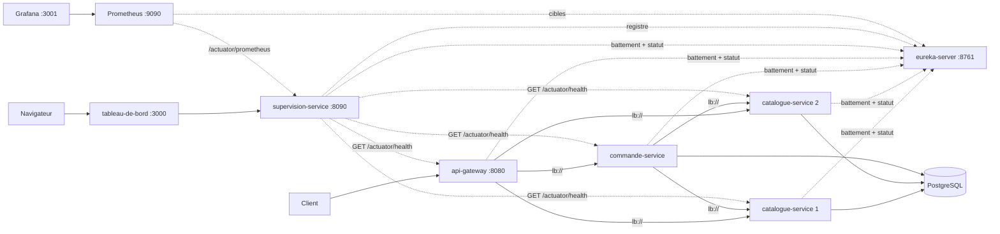

# Supervision et endpoint `/health`

**Eureka, Spring Boot Actuator, états UP/DOWN**
Développement Web Avancé, SID Bambey 2026-2027, binôme 3 : Serigne Ismaila SOUANE et Moussa NIANG.

Une petite boutique en microservices sert de terrain d'essai. Le projet montre comment un service
annonce sa santé, comment Eureka la propage, comment le trafic évite une instance malade, et comment
superviser l'ensemble.

## Démarrage depuis zéro

Prérequis : **Docker Desktop** (4 Go de mémoire disponibles pour Docker), Git et Python 3.9+. Ni Java ni Node ne
sont nécessaires : tout est compilé dans Docker. Le premier build télécharge les dépendances et prend plusieurs minutes.

```bash
cd sante-uadb
scripts/init-env.sh              # crée .env avec des mots de passe aléatoires
docker compose up -d --build --wait
python3 scripts/etat.py          # tout doit être UP après une trentaine de secondes
```

**Sous Windows** (PowerShell), remplacer la première commande par `python scripts\init_env.py`, puis :

```powershell
docker compose up -d --build --wait
python scripts\etat.py
```

| Adresse | Contenu | Compte |
|---------|---------|--------|
| http://localhost:3000 | Tableau de bord React | `supervision` ou `admin` |
| http://localhost:8761 | Console Eureka | `eureka` |
| http://localhost:8080/api/produits | API métier via la passerelle | aucun |
| http://localhost:8090/swagger-ui.html | Contrat OpenAPI de la supervision | aucun pour lire |
| http://localhost:8090/actuator/health | Exemple d'endpoint de santé | anonyme ou `supervision` |
| http://localhost:9090/alerts | Alertes Prometheus | aucun |
| http://localhost:3001/d/sante | Tableau Grafana | `admin` (mot de passe Grafana) |

Les mots de passe sont dans `.env`. Tous les ports n'écoutent que sur `127.0.0.1`.

```bash
python3 scripts/verifier.py      # essai de bout en bout automatique
docker compose down              # arrêter (ajouter -v pour effacer la base)
```

## Architecture



| Dossier | Rôle |
|---------|------|
| `actuator-commun` | Socle partagé : sécurité d'Actuator, statut DEGRADE, traduction vers Eureka, injection de panne |
| `eureka-server` | Registre de services, protégé par mot de passe |
| `api-gateway` | Passerelle, répartit entre les instances UP |
| `catalogue-service`, `commande-service` | Services métier avec leurs indicateurs de santé |
| `supervision-service` | Croise Eureka et Actuator, historise, publie métriques et API |
| `tableau-de-bord` | Interface React |
| `infra`, `scripts`, `charge` | PostgreSQL, Prometheus, Grafana ; mesures et démonstration ; test k6 |
| `docs` | Rapport, backlog, contrats OpenAPI, sécurité, mesures, démonstration |

## Les états

| Actuator | HTTP | Eureka | Trafic | Exemple |
|----------|:----:|--------|:------:|---------|
| `UP` | 200 | UP | oui | tout va bien |
| `DEGRADE` (créé par nous) | 200 | UP | oui | produit en rupture de stock |
| `OUT_OF_SERVICE` | 503 | DOWN | non | maintenance |
| `DOWN` | 503 | DOWN | non | base injoignable |
| *pas de réponse* → `INJOIGNABLE` | aucun | UP puis absente | jusqu'à l'expulsion | processus tué |

## Tests

```bash
./mvnw verify                                 # tests Java (Java 21 requis), couverture JaCoCo dans target/site
cd tableau-de-bord && npm ci && npm test      # tests du tableau de bord
python3 scripts/verifier.py                   # bout en bout, pile démarrée
python3 scripts/mesurer.py rapide             # délais de détection (aussi : sans-sante, defaut)
```

Test de charge k6, sans rien installer :

```bash
docker run --rm --network sante-uadb_services -v "$PWD/charge:/charge:ro" grafana/k6 run /charge/sante.js
```

(Git Bash : préfixer la commande par `MSYS_NO_PATHCONV=1`.)

## Documentation

- [Rapport technique (PDF)](docs/rapport.pdf), source dans [docs/rapport.md](docs/rapport.md)
- [Déroulé de la démonstration](docs/demonstration.md)
- [Backlog et User Stories](docs/backlog.md)
- [Rapport de sécurité](docs/securite.md)
- Contrats OpenAPI : [supervision](docs/openapi/supervision.json), [catalogue](docs/openapi/catalogue.json), [commande](docs/openapi/commande.json)
- [Mesures brutes](docs/mesures)

## Dépannage

| Symptôme | Cause et remède |
|----------|-----------------|
| `lancer scripts/init-env.sh` au démarrage | `.env` absent |
| 503 sur `/api/produits` juste après le démarrage | La passerelle n'a pas encore reçu le registre : attendre 15 s |
| Un conteneur redémarre en boucle | Mémoire insuffisante : donner 4 Go ou plus à Docker Desktop |
| `password authentication failed` (PostgreSQL) | `.env` régénéré alors que le volume existe : `docker compose down -v` |
