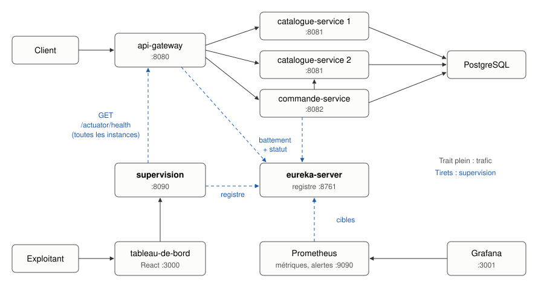
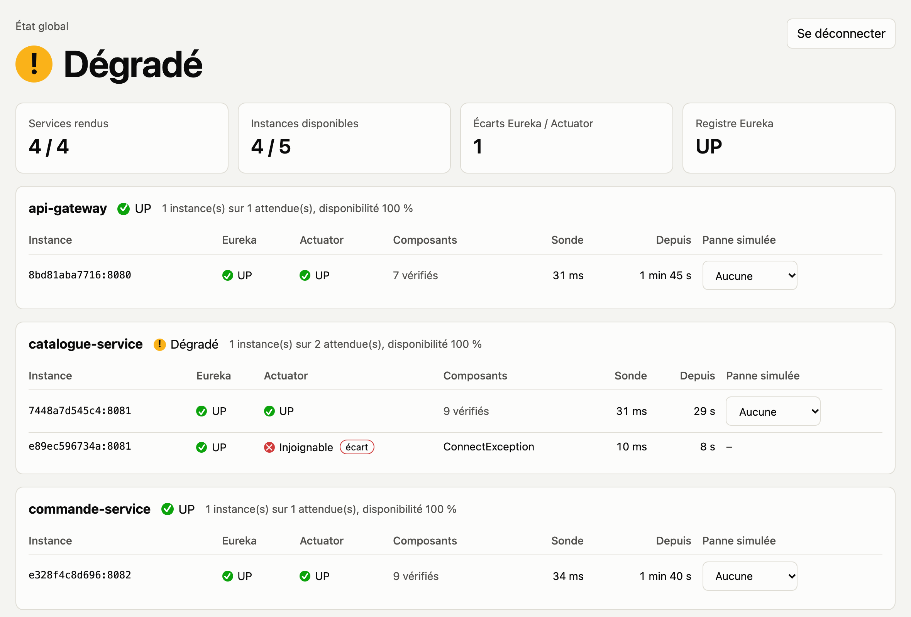
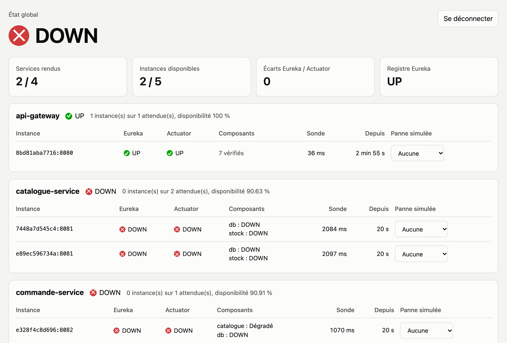
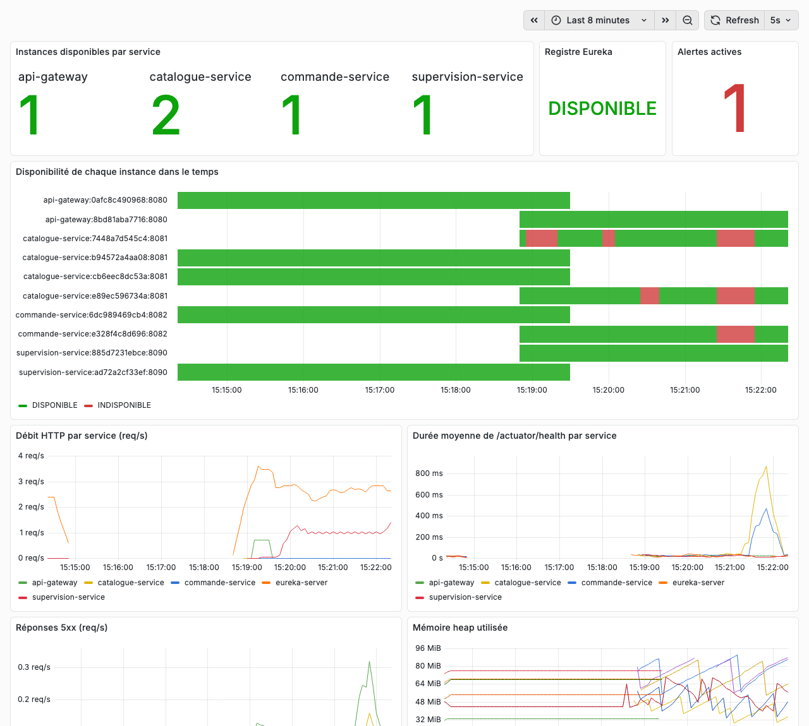
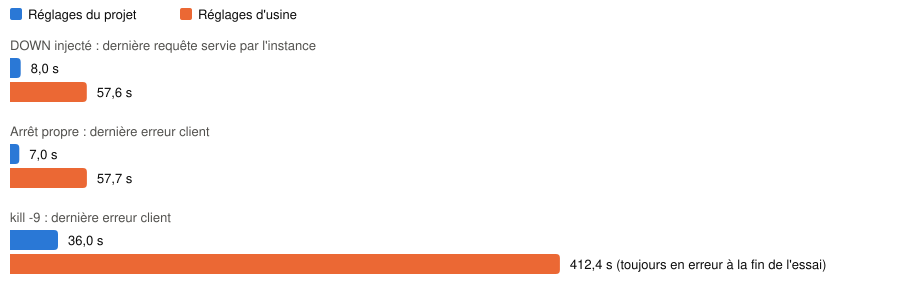
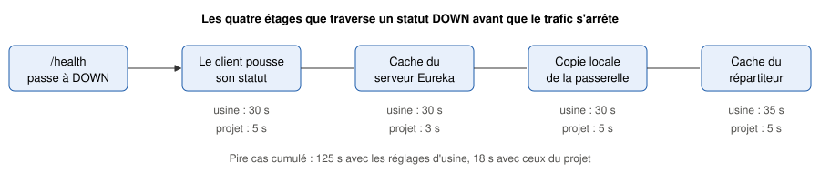

<section class="garde">
<p class="univ">Université Alioune DIOP de Bambey<br>SID, Développement Web Avancé, 2026-2027</p>
<h1>Supervision et endpoint <code>/health</code></h1>
<p class="sous">Eureka, Spring Boot Actuator, états UP/DOWN</p>
<p class="type">Rapport technique, sujet A, binôme 3</p>
<p class="noms">Serigne Ismaila SOUANE<br>Moussa NIANG</p>
<p class="prof">Enseignant : Maodo DIOP</p>
</section>

## Résumé

Un microservice peut être *lancé* sans être *en état de servir*. Ce projet répond à trois questions : comment un service dit-il qu'il va bien, qui l'apprend, et en combien de temps le trafic s'adapte-t-il ?

Nous avons construit une boutique minimale (catalogue et commandes) avec Spring Boot 4, un registre Eureka, une passerelle, un service de supervision et un tableau de bord React. Le tout démarre avec Docker Compose. Puis nous avons provoqué des pannes et chronométré le résultat.

Les quatre constats principaux :

1. **Par défaut, Eureka ne connaît pas la santé.** Base de données coupée, il annonce toujours UP pour les deux instances du catalogue. Avec `eureka.client.healthcheck.enabled=true`, il passe à DOWN en 7,7 s.
2. **Les réglages d'usine privilégient la stabilité.** Une instance tuée brutalement n'a jamais été expulsée pendant nos 412 s d'observation : 49 % des requêtes ont échoué. Avec nos réglages, la dernière erreur survient à 36 s.
3. **Le bail Eureka dure deux fois plus que la valeur configurée**, ce que nous avons mesuré (31,9 s pour 15 s configurées) puis expliqué en lisant le code compilé.
4. **`/actuator/health` a ses propres pièges** : boucle avec Eureka, délais qui s'additionnent, statut personnalisé qui coupe le trafic. Nous les avons rencontrés et corrigés.

## 1. Le sujet

### 1.1 Problème

Dans une application monolithique, savoir si « ça marche » est simple : le processus répond ou non. Avec des microservices, il y a plusieurs instances de chaque service, elles changent d'adresse, et une panne est souvent partielle : le processus tourne, mais sa base est coupée, ou bien une dépendance manque.

Il faut donc trois mécanismes :

| Besoin | Mécanisme | Outil retenu |
|---|---|---|
| Chaque instance décrit son état | Endpoint de santé | Spring Boot Actuator, `/actuator/health` |
| On sait quelles instances existent | Registre de services | Netflix Eureka |
| Quelqu'un regarde et alerte | Supervision | Notre `supervision-service`, Prometheus, Grafana |

### 1.2 Objectifs

- Exposer un endpoint de santé utile et sûr sur chaque service.
- Relier cet endpoint à Eureka pour que le trafic évite les instances malades.
- Superviser l'ensemble et garder l'historique des passages UP/DOWN.
- **Mesurer** les délais de détection, et comprendre ce qui les détermine.

### 1.3 Périmètre

Le code métier est volontairement réduit. La centralisation des logs (notre sujet B), le tracing et le rate limiting (autres binômes) sont exclus. Le backlog complet, avec 17 User Stories et leurs critères d'acceptation, est dans `docs/backlog.md`.

## 2. Notions

### 2.1 Spring Boot Actuator et `/health`

Actuator ajoute à une application des endpoints d'exploitation. `/actuator/health` agrège des **indicateurs** (`HealthIndicator`), chacun répondant pour un composant : `db` exécute une requête de validation, `diskSpace` vérifie l'espace libre, et l'on peut écrire les siens.

```json
{
  "status": "DOWN",
  "components": {
    "db":            { "status": "DOWN" },
    "diskSpace":     { "status": "UP" },
    "livenessState": { "status": "UP" },
    "stock":         { "status": "DOWN" }
  }
}
```

Trois règles à retenir :

- **Agrégation** : le statut global est le pire statut, selon un ordre de gravité configurable.
- **Code HTTP** : UP donne 200, DOWN et OUT_OF_SERVICE donnent 503. Un équilibreur de charge peut donc décider sans lire le JSON.
- **Confidentialité** : les détails ne sont montrés qu'aux utilisateurs autorisés.

### 2.2 Vivacité et préparation

Ce sont deux questions différentes, et les confondre cause des pannes.

| | Vivacité (*liveness*) | Préparation (*readiness*) |
|---|---|---|
| Question | Faut-il redémarrer le processus ? | Peut-on lui envoyer du trafic ? |
| Chemin | `/actuator/health/liveness` | `/actuator/health/readiness` |
| Dépend de la base ? | **Non** | Oui |
| Réaction | L'orchestrateur redémarre | Le trafic est dirigé ailleurs |

Si la vivacité dépendait de PostgreSQL, couper la base ferait redémarrer en boucle tous les services, sans rien réparer. Dans notre projet, le `HEALTHCHECK` Docker utilise la vivacité : pendant une coupure de base, le conteneur reste *healthy* alors que `/health` répond 503. Nous l'avons vérifié.

### 2.3 Eureka

Eureka est un annuaire. Le cycle de vie d'une instance :

1. **Enregistrement** au démarrage : nom, adresse, statut.
2. **Renouvellement** : un battement de cœur toutes les 30 s par défaut.
3. **Récupération** : chaque client copie le registre, toutes les 30 s par défaut.
4. **Annulation** lors d'un arrêt propre, ou **expulsion** quand le bail (90 s par défaut) expire.

Les statuts possibles sont UP, DOWN, STARTING, OUT_OF_SERVICE et UNKNOWN. **Seules les instances UP reçoivent du trafic.**

L'**auto-préservation** protège contre une coupure réseau : si le serveur reçoit moins de 85 % des battements attendus, il suppose que le réseau est en cause et n'expulse plus personne.

Eureka choisit la disponibilité plutôt que la cohérence (AP dans le théorème CAP) : mieux vaut une liste un peu périmée que pas de liste.

### 2.4 Comparaison avec les alternatives

| Solution | Forces | Pourquoi pas ici |
|---|---|---|
| Consul | Contrôles de santé actifs par le serveur, DNS intégré | Le sujet demande Eureka |
| Kubernetes | Découverte et sondes natives | Trop lourd pour nos postes ; mêmes concepts |
| Spring Boot Admin | Interface prête à l'emploi sur Actuator | Ne montre pas l'écart avec Eureka, que nous voulions étudier |
| Prometheus seul | Métriques et alertes | Ne connaît ni les instances attendues ni le détail des composants |

## 3. Architecture



| Module | Rôle | Port |
|---|---|:---:|
| `eureka-server` | Registre de services | 8761 |
| `api-gateway` | Entrée unique, répartition entre instances UP | 8080 |
| `catalogue-service` (2 instances) | Produits et stock | 8081 |
| `commande-service` | Commandes ; appelle le catalogue par son nom | 8082 |
| `supervision-service` | Croise Eureka et Actuator, historise, publie | 8090 |
| `tableau-de-bord` | Interface React servie par nginx | 3000 |
| `actuator-commun` | Bibliothèque partagée | aucun |

**Technologies** : Java 21, Spring Boot 4.0.10, Spring Cloud 2025.1.5, PostgreSQL 17, React 19, Prometheus, Grafana, Docker Compose. Spring Cloud 2025.1 est le train compatible avec Spring Boot 4.0 ; nous n'avons pas pris Spring Cloud 2026.0, construit pour Boot 4.2.

### 3.1 Décisions

| Décision | Raison | Contrepartie |
|---|---|---|
| La supervision n'a pas de base de données | Elle ne doit pas tomber avec ce qu'elle surveille | Historique perdu au redémarrage |
| Le tableau de bord contourne la passerelle | Si la passerelle tombe, l'écran doit l'afficher | Un port de plus |
| Une base et un compte PostgreSQL par service | Isolation des données | Un seul serveur : panne commune |
| Catalogue en deux instances | Montrer la bascule | Plus de mémoire |
| Enregistrement Eureka par nom et non par IP | Voir 7.1 | Dépend du DNS Docker |

### 3.2 Contrats d'API

Chaque API est décrite en OpenAPI, générée depuis le code et exportée dans `docs/openapi`. Les principales opérations :

| Méthode | Chemin | Rôle requis |
|---|---|---|
| GET | `/api/produits`, `/api/commandes` | aucun |
| POST | `/api/commandes` | aucun |
| POST | `/api/produits/{id}/reapprovisionnements` | ADMIN |
| GET | `/api/supervision/etat` | SUPERVISION |
| GET | `/api/supervision/services/{nom}` | SUPERVISION |
| GET | `/api/supervision/evenements` | SUPERVISION |
| PUT, DELETE | `/api/supervision/instances/{id}/panne` | ADMIN |

## 4. Réalisation de l'endpoint de santé

### 4.1 Configuration commune

Tous les services importent le même fichier, `supervision-commun.yml`. Extrait :

```yaml
management:
  endpoints.web.exposure.include: health,info,metrics,prometheus,panne
  endpoint:
    health:
      show-details: when-authorized
      show-components: when-authorized
      roles: SUPERVISION
      status:
        order: DOWN,OUT_OF_SERVICE,DEGRADE,UP,UNKNOWN
        http-mapping: { DOWN: 503, OUT_OF_SERVICE: 503, DEGRADE: 200 }
eureka:
  client:
    healthcheck:
      enabled: true
```

L'exposition est une liste blanche. `env` et `heapdump`, qui révèlent des secrets, répondent 404 même à un administrateur ; un test le garantit.

### 4.2 Indicateurs de santé personnalisés

**Stock** (catalogue) : une rupture dégrade le service sans l'arrêter.

```java
@Override
protected void doHealthCheck(Health.Builder sante) {
    // Une exception ici (base coupée) est convertie en DOWN par AbstractHealthIndicator
    long ruptures = produits.countByStock(0);
    sante.status(ruptures == 0 ? Status.UP : Statuts.DEGRADE)
            .withDetail("produitsEnRupture", ruptures);
}
```

**Catalogue** (commande) : l'indicateur lit dans Eureka combien d'instances du catalogue sont disponibles. S'il n'y en a aucune, le service est `DEGRADE` et non `DOWN`. Les commandes existantes restent consultables, et surtout un DOWN se propagerait de service en service : c'est la **panne en cascade**.

**Panne simulée** : composant réservé à la démonstration, piloté par un endpoint Actuator écrit par nous (`@Endpoint(id = "panne")`). Il est absent si `PANNE_ACTIVE` n'est pas à `true`.

### 4.3 Le statut DEGRADE et Eureka

Spring permet de créer ses propres statuts. Mais Eureka n'en connaît que cinq. En lisant la classe `EurekaHealthCheckHandler`, nous avons constaté qu'un statut inconnu devient UNKNOWN, et qu'une instance UNKNOWN n'est plus routée. Une rupture de stock aurait donc coupé le catalogue. Notre correction :

```java
@Override
protected InstanceStatus mapToInstanceStatus(Status statut) {
    return Statuts.DEGRADE.equals(statut) ? InstanceStatus.UP
                                          : super.mapToInstanceStatus(statut);
}
```

Deux tests fixent ce comportement : l'un prouve le défaut sans notre classe, l'autre prouve la correction.

Autre surprise : `OUT_OF_SERVICE` est traduit en `DOWN`. Nous pensions à une erreur dans notre test ; c'est un choix de Spring Cloud. Côté serveur, la règle `LeaseExistsRule` conserve un bail déjà OUT_OF_SERVICE : l'instance ne repasserait pas d'elle-même à UP. DOWN est réversible.

### 4.4 Correspondance des états

| Situation | Actuator | HTTP | Eureka | Reçoit du trafic |
|---|---|:---:|---|:---:|
| Tout va bien | UP | 200 | UP | oui |
| Rupture de stock | DEGRADE | 200 | UP | oui |
| Maintenance | OUT_OF_SERVICE | 503 | DOWN | non |
| Base coupée | DOWN | 503 | DOWN | non |
| Processus tué | pas de réponse | aucun | UP, puis absente | oui, jusqu'à l'expulsion |

## 5. Le service de supervision

### 5.1 Principe

Toutes les 5 s, le service lit sa copie du registre Eureka, puis interroge en parallèle `/actuator/health` de chaque instance. Il confronte les deux sources :

- elles concordent : tout va bien, ou bien la panne est connue ;
- elles **divergent** : c'est l'information la plus intéressante. « Eureka UP, Actuator injoignable » signifie que du trafic part vers une instance morte.

### 5.2 Points de conception

**Voir aussi les instances DOWN.** Le client Eureka ne garde par défaut que les instances UP. Un superviseur doit voir les autres : `filter-only-up-instances: false`.

**Un 503 n'est pas une erreur.** Avec `retrieve()`, le client HTTP de Spring lève une exception sur un 503 et l'on perd le corps de la réponse, donc le diagnostic. Nous utilisons `exchange()`.

**Éviter les fausses alertes.** Une instance n'est déclarée INJOIGNABLE qu'après deux échecs consécutifs. Un DOWN explicite est pris en compte aussitôt, puisque c'est l'instance elle-même qui le déclare.

**Sondes parallèles et bornées.** Chaque sonde s'exécute dans un thread virtuel, avec un délai de connexion de 1 s et de réponse de 3 s. Le cycle suivant attend la fin du précédent (`fixedDelay`), donc les sondes ne s'empilent jamais.

**Services attendus.** Un service qui n'a jamais démarré est invisible dans Eureka. La configuration liste donc les services attendus et leur nombre minimal d'instances ; un absent est affiché DOWN.

**Instances disparues.** Une instance qui quitte Eureka reste affichée « Absente » pendant 3 minutes, le temps qu'un humain comprenne, puis elle est retirée.

**Survivre à Eureka.** Si le registre tombe, sa copie locale reste lisible : la supervision continue et passe l'état global à DEGRADE.

### 5.3 Calcul de l'état d'un service

| Instances disponibles | État du service |
|---|---|
| 0 | DOWN |
| moins que le minimum attendu | DEGRADE |
| minimum atteint, mais une instance dégradée | DEGRADE |
| minimum atteint, toutes UP | UP |

L'état global est le pire état des services. La disponibilité affichée est la part des sondes où le service était rendu, décomptée à partir de sa première apparition : le temps de démarrage n'est pas une panne.

### 5.4 Tableau de bord



*Capture : une instance du catalogue vient d'être tuée. Eureka la croit UP, Actuator ne répond plus. L'écart est signalé, le service est dégradé mais rendu.*

L'interface se rafraîchit toutes les 2 s. Chaque état porte une icône et un texte, jamais la couleur seule. Les identifiants restent en mémoire (ni cookie, ni stockage local). Le compte `admin` voit en plus un sélecteur pour injecter une panne.



*Capture : PostgreSQL arrêté. Le détail désigne la cause, `db`, et les deux sources concordent.*

### 5.5 Métriques et alertes

Prometheus n'a aucune adresse de service écrite en dur : il découvre ses cibles dans Eureka (`eureka_sd_configs`). Cinq règles d'alerte :

| Alerte | Condition | Gravité |
|---|---|---|
| ServiceIndisponible | aucune instance disponible pendant 10 s | critique |
| InstanceIndisponible | instance indisponible pendant 10 s | alerte |
| InstanceInstable | plus de 6 transitions en 5 min (*flapping*) | alerte |
| EurekaIndisponible | registre sans réponse pendant 10 s | critique |
| SupervisionAbsente | plus de métriques de supervision pendant 20 s | critique |

La dernière répond à la question « qui surveille le surveillant ? ».



*Capture : tableau Grafana après une série de pannes. Les segments rouges sont les indisponibilités d'instances.*

## 6. Mesures

### 6.1 Protocole

Le script `scripts/mesurer.py` provoque chaque panne, relève les délais, et maintient pendant l'essai un trafic d'environ 10 requêtes par seconde à travers la passerelle. Trois profils :

| Paramètre | Usine | Projet |
|---|:---:|:---:|
| Battement de cœur | 30 s | 5 s |
| Expiration du bail | 90 s | 15 s |
| Cycle d'expulsion | 60 s | 5 s |
| Cache de réponse du serveur | 30 s | 3 s |
| Rafraîchissement du registre client | 30 s | 5 s |
| Réplication du statut | 30 s | 5 s |
| Cache du répartiteur de charge | 35 s | 5 s |
| Auto-préservation | active | inactive |

Le troisième profil, `sans-sante`, reprend les réglages du projet avec `healthcheck.enabled=false`.

**Conditions.** Un MacBook Air (8 Go, 8 cœurs), toute la pile sur la même machine. Chaque scénario a été joué **une fois** par profil : les valeurs donnent des ordres de grandeur, pas des moyennes. La résolution de la supervision est de 5 s, sa période de sonde. Après les mesures, seules des versions de bibliothèques ont changé (voir 8.3).

### 6.2 Résultats

| Scénario | Indicateur | Projet | Usine |
|---|---|---:|---:|
| **DOWN injecté** | vu par la supervision | 2,3 s | 2,9 s |
| | vu dans Eureka | 4,6 s | 28,6 s |
| | dernière requête servie par l'instance | 8,0 s | 57,6 s |
| | erreurs client | 0 sur 118 | 0 sur 699 |
| **Arrêt propre** (SIGTERM) | vu par la supervision | 6,7 s | 9,9 s |
| | retirée d'Eureka | 2,5 s | 17,3 s |
| | dernière erreur client | 7,0 s | 57,7 s |
| | erreurs client | 8 sur 131 | 148 sur 845 |
| **Arrêt brutal** (`kill -9`) | vu par la supervision | 10,0 s | 9,1 s |
| | retirée d'Eureka | 31,9 s | jamais (330 s) |
| | dernière erreur client | 36,0 s | en erreur à 412&nbsp;s |
| | erreurs client | 58 sur 207 (28&nbsp;%) | 1&nbsp;765 sur 3&nbsp;598 (49&nbsp;%) |
| **Base arrêtée** | vu par la supervision | 6,6 s | 7,5 s |
| | DOWN dans Eureka | 7,7 s | 33,9 s |
| | retour à UP dans Eureka | 13,9 s | 29,1 s |



*Durée pendant laquelle une instance défaillante a encore affecté le client.*

### 6.3 Analyse

**Sans contrôle de santé, Eureka se trompe.** Profil `sans-sante`, base arrêtée : pendant les 60 s d'observation, Eureka annonce `["UP", "UP"]` et la supervision compte deux écarts. C'est le comportement par défaut de Spring Cloud.

**Un statut DOWN traverse quatre étages** avant que le trafic s'arrête.



Le pire cas d'usine est de 125 s ; nous avons observé 57,6 s, ce qui est cohérent puisque chaque étage est traversé en moyenne à mi-période. Accélérer un seul étage ne suffit pas. Le cache du répartiteur (35 s) est le plus souvent oublié.

**Arrêt propre : prévenir ne suffit pas.** L'instance se désinscrit elle-même, mais les copies locales la proposent encore. D'où 8 erreurs, et 148 avec les réglages d'usine. Un arrêt sans erreur demanderait de passer d'abord hors service, d'attendre la propagation, puis de s'arrêter.

**Arrêt brutal : le bail double.** Configuré à 15 s, le bail expire au bout de 31,9 s. Nous avons décompilé `com.netflix.eureka.lease.Lease` : `renew()` mémorise *maintenant + durée*, puis `isExpired()` compare à *cette valeur + durée*. La durée est comptée deux fois, donc 2 × 15 s plus le cycle d'expulsion. Avec 90 s, il faudrait au moins 180 s.

**Arrêt brutal, réglages d'usine : jamais expulsée.** L'explication la plus probable est l'auto-préservation : la perte d'une instance sur cinq fait passer les battements sous le seuil de 85 %. Pensée pour de grands parcs, elle est inadaptée au nôtre. Une instance sur deux étant morte, environ une requête sur deux échoue : 49 %.

**La sonde directe est insensible à ces réglages** : 9 à 10 s dans les deux cas. Deux sondes ratées à 5 s d'intervalle suffisent. C'est l'intérêt d'une supervision active à côté d'un registre passif.

**L'écart mesuré à l'arrêt de la base** (2 divergences au moment du relevé) est transitoire : la supervision sonde avant d'avoir reçu la nouvelle copie du registre.

### 6.4 Faut-il alors tout accélérer ?

Non. Des délais courts multiplient les échanges avec Eureka et augmentent le risque d'expulser une instance simplement lente (pause du ramasse-miettes, surcharge). Nos valeurs conviennent à une démonstration. En production, nous garderions l'auto-préservation, réduirions le cache du répartiteur, et ajouterions un essai sur une autre instance en cas d'échec, seul moyen d'effacer les erreurs pendant la propagation.

### 6.5 Test de charge

Sonder a un coût. k6 a envoyé 100 requêtes par seconde pendant 30 s sur chaque cible, après 30 s de chauffe (553 requêtes par seconde en moyenne sur l'essai, chauffe comprise).

| Cible | Médiane | p95 | p99 | Max |
|---|---:|---:|---:|---:|
| `/actuator/health/liveness` | 1,66 ms | 4,26 ms | 9,94 ms | 48 ms |
| `/actuator/health/readiness` | 1,75 ms | 5,50 ms | 20,05 ms | 163 ms |
| `/actuator/health` complet | 2,11 ms | 4,76 ms | 12,17 ms | 48 ms |
| `GET /api/produits` via la passerelle | 2,86 ms | 6,79 ms | 21,54 ms | 82 ms |

94 063 requêtes, aucune erreur, tous les seuils respectés. Le contrôle complet coûte un peu plus que la vivacité, car il interroge la base. Le coût reste négligeable au rythme d'une sonde toutes les 5 s.

Un premier tir a été **rejeté** : l'ordinateur s'était mis en veille pendant l'essai, ce que trahissait un temps maximal de 44 minutes. Nous l'avons rejoué en empêchant la veille.

## 7. Difficultés rencontrées

Un seul de ces problèmes (7.3) a été trouvé par un test automatisé. Les autres ne sont apparus qu'en exécutant la pile réelle, alors que les tests passaient.

### 7.1 Une instance enregistrée avec la mauvaise adresse

Le catalogue est relié à deux réseaux Docker. Il annonçait parfois à Eureka l'IP du réseau de la base, injoignable pour les autres. Eureka affichait UP, notre supervision INJOIGNABLE : l'outil a trouvé un vrai défaut dans notre propre projet. **Correction** : s'enregistrer par nom d'hôte, résolu par le DNS Docker.

### 7.2 La passerelle sans délai

Vers cette adresse muette, la passerelle restait bloquée plusieurs minutes. **Correction** : `connect-timeout: 1s`, `read-timeout: 5s`.

### 7.3 Une erreur 500 au lieu de 503

Sans aucune instance disponible, la passerelle laissait remonter une exception. Un test l'a révélé. **Correction** : un `HandlerExceptionResolver` qui répond 503, la réponse exacte.

### 7.4 La boucle Eureka et Actuator

L'indicateur `discoveryComposite` fourni par Spring Cloud relit dans Eureka le statut du service lui-même (`getInstanceRemoteStatus`). Or ce statut dépend de `/health`. Une fois DOWN, le service se voyait DOWN dans Eureka, ce qui retardait son retour à UP. **Correction** : indicateur désactivé ; la supervision sonde Eureka séparément.

### 7.5 Des délais qui s'additionnent

Base coupée, le catalogue était INJOIGNABLE au lieu de DOWN : on perdait la cause. Les indicateurs s'exécutent **l'un après l'autre** : `db` (2 s) puis `stock` (2 s) dépassaient les 3 s accordées par la sonde. **Correction** : délai de connexion de 1 s dans HikariCP. Règle à retenir : *nombre d'indicateurs lents × leur délai < délai de la sonde*.

### 7.6 Un compte refusé sur un endpoint public

La santé d'Eureka est publique, mais la sonde envoyait un compte qu'Eureka ne connaît pas. Spring Security répond 401 à des identifiants faux, **même sur une page publique**. **Correction** : sonde anonyme pour Eureka.

### 7.7 Un build qui échoue sans se faire remarquer

Après une mise à jour de bibliothèques, la construction des images a échoué (coupures réseau), mais la commande suivante a redémarré les **anciennes** images, et `verifier.py` a conclu « Tout est conforme ». Le résultat était vrai, mais sur l'ancien code. **Correction** : cache Maven persistant dans le Dockerfile, et vérification de la date des images avant de conclure. Même leçon que pour `/health` : s'assurer de ce que l'on mesure.

### 7.8 Disque plein

Les images et caches Docker ont saturé le disque pendant le développement, et Docker est passé en lecture seule. Une supervision complète devrait aussi surveiller la machine hôte.

## 8. Sécurité

Le rapport détaillé est dans `docs/securite.md`. L'essentiel :

### 8.1 Protections

| Risque | Réponse |
|---|---|
| Fuite d'information par Actuator | Liste blanche ; détails réservés au rôle SUPERVISION ; `env` et `heapdump` absents |
| Fausse instance enregistrée dans Eureka | Registre protégé par mot de passe |
| Abus de l'injection de panne | Rôle ADMIN, inactive par défaut |
| SSRF via la supervision | L'appelant fournit un identifiant connu, jamais une URL |
| Secrets dans le dépôt | `.env` ignoré par Git, généré aléatoirement ; démarrage refusé s'il manque |
| Évasion de conteneur | Utilisateur non root, système de fichiers en lecture seule (services Java), aucune capacité Linux |
| Exposition réseau | Ports sur `127.0.0.1` ; base sur un réseau interne |
| XSS sur le tableau de bord | CSP stricte, React, aucun identifiant stocké |

### 8.2 Limites assumées

Les échanges internes sont en HTTP clair, l'authentification Basic n'a pas de limite d'essais, les API métier sont ouvertes, et Prometheus n'a pas de mot de passe. C'est acceptable sur un poste local, pas en production.

### 8.3 Analyse des dépendances

Le script `scripts/scanner.py` interroge la base OSV pour 285 paquets (198 bibliothèques Java, 87 paquets système).

| | Avant | Après correction |
|---|:---:|:---:|
| Dépendances Java | 5 | 0 |
| Paquets Alpine | 42 | 3 |

Les failles Java venaient de bibliothèques tirées par Eureka et Spring Cloud (guava, httpclient), que nous avons relevées. Les failles système venaient surtout de l'image nginx, désormais mise à jour à la construction. Trois CVE subsistent sur `expat`, que notre code n'utilise pas. Les tests et l'essai de bout en bout ont été rejoués après ces changements. Trivy a vérifié en local la configuration (Dockerfiles) et l'absence de secrets : aucun problème. Son analyse de vulnérabilités n'a pas pu tourner en local (téléchargement de sa base impossible) ; la CI l'exécute sur les six images.

## 9. Qualité

### 9.1 Tests

| Niveau | Outil | Nombre |
|---|---|:---:|
| Unitaires et intégration Java | JUnit, Mockito, MockMvc | 51 |
| Interface | Vitest, Testing Library | 9 |
| Bout en bout sur la pile réelle | `scripts/verifier.py` | 19 contrôles |
| Charge | k6 | 5 scénarios |

La couverture de lignes Java est de 75 % (supervision : 86 %, la partie centrale). `actuator-commun` affiche 43 % seul, car il est surtout exercé par les tests des services qui l'utilisent, et JaCoCo mesure ici module par module.

La sonde est testée contre un vrai serveur HTTP (503, lenteur, JSON invalide, connexion refusée), et la sécurité par des requêtes anonymes, SUPERVISION et ADMIN.

### 9.2 Intégration continue

Le fichier `.github/workflows/ci.yml` définit trois travaux :

1. tests Java sous **Linux, Windows et macOS**, car notre binôme travaille sur macOS et Windows ;
2. tests, build et audit npm de l'interface ;
3. construction des images, démarrage de la pile complète, `verifier.py`, puis scan Trivy des fichiers et des six images.

L'action Trivy est épinglée par empreinte de commit plutôt que par étiquette, car une étiquette peut être déplacée vers du code malveillant.

La pipeline est écrite mais **n'a pas encore été exécutée sur GitHub** au moment de la rédaction. Les commandes Java, npm, Docker et `verifier.py` qu'elle enchaîne ont été exécutées en local sous macOS.

### 9.3 Portabilité

Les scripts de démonstration sont en Python sans dépendance ; `.gitattributes` force les fins de ligne Unix, car un script en CRLF ne démarre pas dans un conteneur Linux. Le projet a été essayé sous macOS ; l'essai sous Windows reste à faire.

## 10. Organisation

### 10.1 Répartition du travail

Chaque membre a pris en charge les parties suivantes, avec l'assistance décrite en 10.2.

| Membre | Parties prises en charge |
|---|---|
| Serigne Ismaila SOUANE | Tableau de bord React, Docker et Compose, Prometheus et Grafana, essai sous macOS |
| Moussa NIANG | Services Java, Eureka, service de supervision, sécurité |

### 10.2 Usage de l'intelligence artificielle

L'énoncé autorise l'IA à condition de comprendre le sujet. Nous avons utilisé **Claude Code** (Anthropic) de façon importante : écriture du code, des tests, des scripts et de la première version de ce rapport, exécution des mesures et diagnostic des défauts de la section 7.

Deux garde-fous : les chiffres proviennent d'exécutions réelles, dont les fichiers bruts sont dans `docs/mesures` ; les affirmations sur Spring et Eureka citées en 4.3, 6.3 et 7.4 ont été vérifiées dans le code compilé des bibliothèques. L'explication de l'auto-préservation (6.3) est une interprétation, signalée comme telle.

## 11. Bilan

### 11.1 Ce que nous retenons

- *Lancé* ne veut pas dire *en état de servir* : il faut demander au service lui-même.
- Un registre sait ce qu'on lui déclare ; une sonde sait ce qu'elle constate. Il faut les deux.
- Le délai perçu par le client est la somme de caches que personne ne regarde.
- Un contrôle de santé mal conçu propage les pannes au lieu de les contenir.
- Mesurer change les idées : deux de nos hypothèses (le bail de 15 s, la traduction d'OUT_OF_SERVICE) étaient fausses.

### 11.2 Limites

- Un seul serveur Eureka, donc un point de défaillance unique pour les changements d'état.
- Une seule exécution par mesure, sur une seule machine.
- Réservation de stock et enregistrement de commande non transactionnels entre services : si le second échoue, le stock reste réservé.
- Historique de supervision en mémoire.

### 11.3 Perspectives

1. Eureka en cluster et auto-préservation active.
2. Nouvel essai sur une autre instance dans la passerelle.
3. Arrêt en deux temps : OUT_OF_SERVICE, propagation, arrêt.
4. Alertmanager pour notifier par courriel.
5. Rapprochement avec le sujet B : relier un passage à DOWN aux logs de l'instance.

## Annexe A. Démarrer le projet

```bash
scripts/init-env.sh
docker compose up -d --build --wait
python3 scripts/etat.py
python3 scripts/verifier.py
```

| Adresse | Contenu |
|---|---|
| http://localhost:3000 | Tableau de bord |
| http://localhost:8761 | Console Eureka |
| http://localhost:8080/api/produits | API métier |
| http://localhost:8090/swagger-ui.html | Contrat OpenAPI |
| http://localhost:9090/alerts | Alertes |
| http://localhost:3001/d/sante | Grafana |

## Annexe B. Glossaire

| Terme | Sens |
|---|---|
| Bail (*lease*) | Durée pendant laquelle Eureka considère une instance vivante sans nouveau battement |
| Expulsion | Retrait par Eureka d'une instance dont le bail a expiré |
| Flapping | Alternance rapide entre UP et DOWN |
| Indicateur de santé | Classe qui évalue l'état d'un composant |
| Sonde | Requête périodique vérifiant un état |
| SSRF | Faire émettre par un serveur une requête choisie par l'attaquant |

## Annexe C. Références

- Documentation Spring Boot, Actuator : https://docs.spring.io/spring-boot/reference/actuator/
- Spring Cloud Netflix : https://docs.spring.io/spring-cloud-netflix/reference/
- Netflix Eureka : https://github.com/Netflix/eureka/wiki
- Prometheus, découverte Eureka : https://prometheus.io/docs/prometheus/latest/configuration/configuration/
- k6 : https://grafana.com/docs/k6/
- OSV : https://osv.dev
